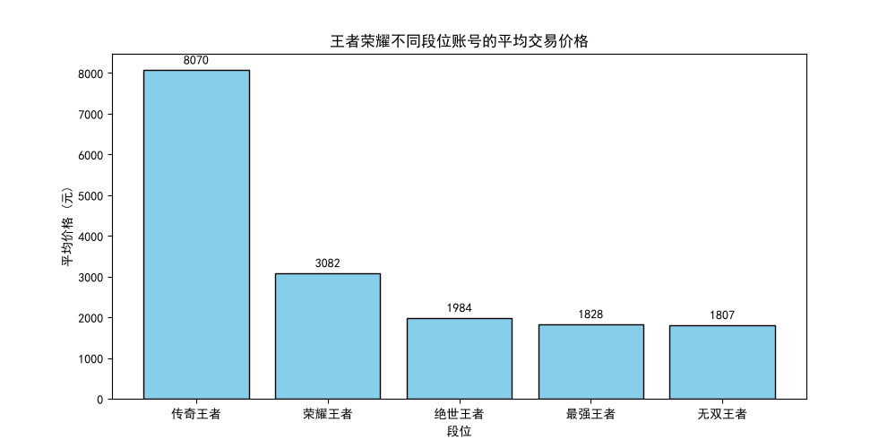
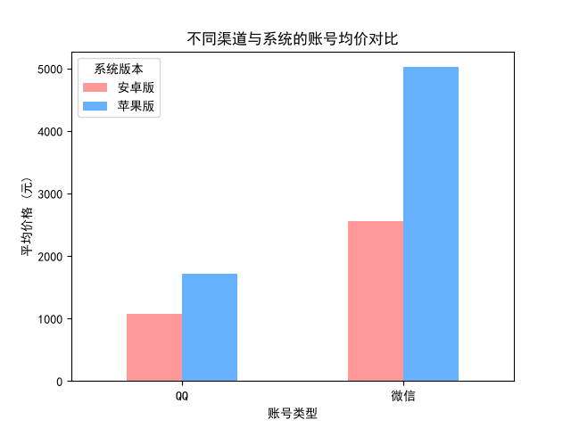
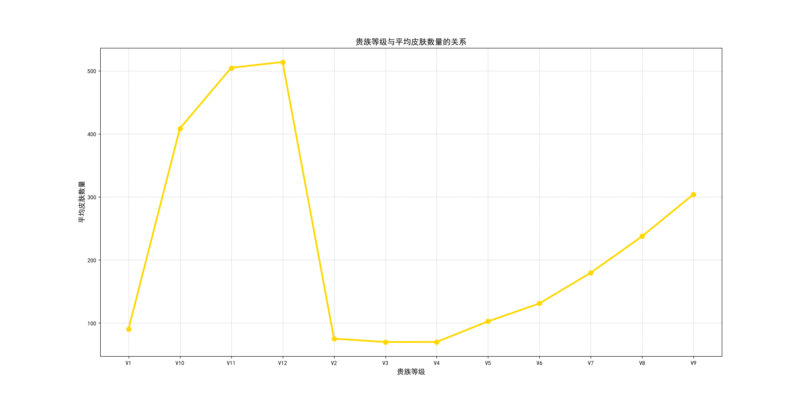

# 王者荣耀账号交易市场深度洞察分析

本项目基于 Python (Pandas & Matplotlib) 对 2.5W+ 条真实交易数据进行了清洗、多维分析与可视化，旨在探究虚拟账号的定价逻辑与核心溢价因素。

## 📈 核心业务发现

* **基础概况**：有效数据 25485 行，账号平均售价为 **1343.81 元**，最高单笔交易达 **130,000 元**。
* **段位溢价**：“传奇王者”段位账号均价高达 **8069 元**，是普通王者段位的 2.6 倍。
* **付费特征**：通过皮尔逊相关系数分析，皮肤数量与账号价格呈中等正相关（**0.413**）。
* **渠道差异**：通过交叉分析发现，微信区账号均价高于 QQ 区，且 iOS 端账号整体溢价高于安卓端。
* **高净值画像**：随着贵族等级（V1-V10）提升，平均皮肤数量呈明显的线性增长，V10 玩家为平台核心资产。

## 💡 深度洞察：打破“段位定价”迷思
通过检测 Top 10 高价账号发现一个**反直觉结论**：顶级交易市场中，段位并非核心溢价因素。
* 例如，全平台最贵账号（标价 13 万元）段位仅为“永恒钻石”，但其拥有“全息碎影”、“无限飓风号”等绝版/典藏皮肤。
* 这揭示了一个真实的玩家需求：**高净值玩家更愿意为“稀缺资产（皮肤/收藏品）”买单，而非单纯的竞技段位。**

## 🖼️ 可视化成果

**1. 各段位账号均价对比 (分析核心资产溢价)**

**2. 渠道与系统对价格的影响 (分析平台用户购买力)**

**3. 贵族等级与皮肤数量关系 (高净值玩家画像)**

## 🛠️ 技术栈
* **Python** (核心语言)
* **Pandas** (数据清洗、Groupby 聚合、相关性分析)
* **Matplotlib** (多维度数据可视化)
